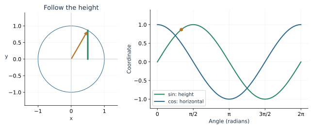
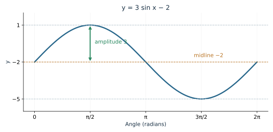
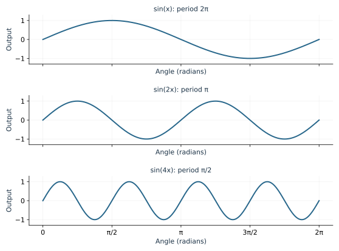
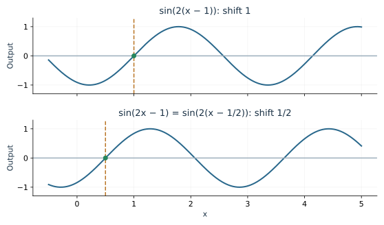
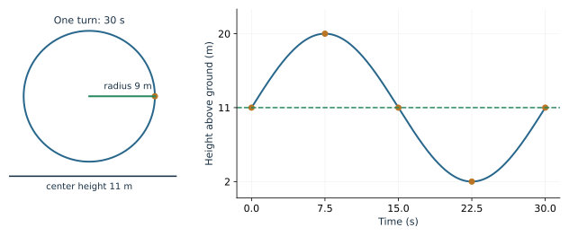

A rotating point returns to the same position after one turn. Its height also returns to the same value, producing a repeating wave when height is plotted against time. A wheel, a vibrating string, and a buoy can have very different sizes and speeds while sharing this mathematical pattern.

This chapter connects a wave's visible features to the numbers in its equation. We will read those numbers from a graph, change them one at a time, and build models from measurements.

## Identify a cycle and its period

A function is periodic when a positive shift of its input reproduces all its values: \(f(x+T)=f(x)\), with the domain also preserved by that shift. The least positive such \(T\), when one exists, is the fundamental period.

For sine and cosine, a full turn restores both coordinates:
\[
\sin(x+2\pi)=\sin x,\qquad
\cos(x+2\pi)=\cos x.
\]
Their fundamental period is \(2\pi\) radians. If the input is time, a period has time units instead. The equation's inside angle determines how time becomes rotation.

Cosine begins at 1 when its angle is zero. Sine begins at zero and initially rises. They describe coordinates a quarter-turn apart, so either can model the same repeating quantity after an appropriate shift.

## Read amplitude and midline from the extremes

Consider \(y=A\sin x+D\). Multiplication by \(A\) changes the vertical scale, and adding \(D\) changes the center of the wave.

The **midline** is \(y=D\). The **amplitude** is the nonnegative distance \(|A|\) from the midline to either extreme. Thus
\[
\text{minimum}=D-|A|,\qquad
\text{maximum}=D+|A|.
\]

For \(y=3\sin x-2\), the amplitude is 3 and the midline is \(-2\). The minimum is \(-5\), maximum is 1, and range is \([-5,1]\).

If a graph or measurement gives maximum \(M\) and minimum \(m\), recover the two quantities by
\[
|A|=\frac{M-m}{2},\qquad D=\frac{M+m}{2}.
\]
The midpoint of the extremes gives the midline; half their separation gives the amplitude.

::: {.example}
**Worked example: a daily temperature model.** Suppose a roughly sinusoidal temperature varies between \(14^\circ\text{C}\) and \(26^\circ\text{C}\). The midline is \(20^\circ\text{C}\), and the amplitude is \(6^\circ\text{C}\). These two measurements establish the vertical scale but leave the period and starting phase to be determined.
:::

A negative coefficient reflects a wave across its midline. The graphs \(4\sin x\) and \(-4\sin x\) have the same range and amplitude, but one initially rises while the other initially falls.

**Try it.** A signal ranges from \(-7\) to 5. Find its amplitude and midline, then write one sine model with those extremes.

## A multiplier inside the function changes the period

For \(y=\sin(Bx)\), one cycle occurs when the inside angle \(Bx\) changes by \(2\pi\). Therefore
\[
T=\frac{2\pi}{|B|},\qquad B\ne0.
\]
For \(\sin(2x)\), an input increase of \(\pi\) makes the inside angle increase by \(2\pi\). Two cycles fit where \(\sin x\) completes one.

The period of \(\cos(4x)\) is \(\pi/2\). If \(x\) is measured in seconds and \(B\) is an angular frequency, the period is in seconds. For a model \(\sin(\omega t)\),
\[
\omega=\frac{2\pi}{T}\text{ radians per unit time},\qquad
f=\frac1T=\frac{|\omega|}{2\pi}\text{ cycles per unit time}.
\]
Frequency \(f\) counts cycles. Angular frequency \(|\omega|\) counts radians during the same amount of time.

::: {.example}
**Worked example: revolutions per minute.** A mechanism rotates 90 times each minute. That is \(90/60=1.5\) cycles per second. Its period is \(1/1.5=2/3\) s, and its angular speed is \(2\pi(1.5)=3\pi\) rad/s.
:::

The sign of \(B\) reverses the direction of the inside angle. The period uses \(|B|\). For ordinary sine models, a negative \(B\) can be absorbed into the sign of \(A\).

## Factor the inside expression to read a shift

A convenient form is
\[
y=A\sin(B(x-C))+D.
\]
The graph has amplitude \(|A|\), midline \(D\), period \(2\pi/|B|\), and a horizontal shift \(C\). The expression \(x-C\) becomes zero at \(x=C\), so the familiar start of the sine cycle moves there.

The form of the parentheses matters. In \(\sin(2(x-1))\), the shift is 1. In \(\sin(2x-1)\), factor first:
\[
\sin(2x-1)=\sin\bigl(2(x-\tfrac12)\bigr).
\]
Its shift is \(1/2\).

::: {.example}
**Worked example: read a transformed equation.**
\[
y=2\sin(3x-\pi)+1
=2\sin\left(3\left(x-\frac{\pi}{3}\right)\right)+1.
\]
Its amplitude is 2, midline 1, period \(2\pi/3\), and shift \(\pi/3\) to the right. Its range is \([-1,3]\).
:::

The same ideas work for cosine. Remember its different starting value: a positive cosine coefficient begins a cycle at a maximum, while a positive sine coefficient begins at an upward midline crossing.

**Try it.** Rewrite \(3\cos(5x-\pi)+2\) in shifted form and identify its amplitude, period, shift, midline, and range.

## Plot five landmarks before drawing the wave

Divide one period into four equal intervals. For \(A\sin(B(x-C))+D\) with \(B>0\), one cycle has the points
\[
\begin{array}{c|ccccc}
x&C&C+T/4&C+T/2&C+3T/4&C+T\\
\hline
y&D&D+A&D&D-A&D
\end{array}
\]
For cosine, the outputs are \(D+A,D,D-A,D,D+A\). Signed \(A\) is useful here: a negative \(A\) automatically reverses the high and low values.

::: {.example}
**Worked example: a reflected cosine.** For \(y=-2\cos(\pi(x-1))+3\), the period is 2. Beginning at \(x=1\), the landmarks are
\[
(1,1),\quad(3/2,3),\quad(2,5),\quad(5/2,3),\quad(3,1).
\]
The cycle begins at a minimum because the cosine coefficient is negative. Draw a smooth wave through those points.
:::

The [Sinusoid Explorer](../demos/sinusoid_explorer.html) marks these landmarks and lists their coordinates. Keep the viewing axes fixed while comparing shifts. Use its cycle view when you want to inspect a single period closely.

## Build a model from a wheel

A wheel has radius 9 m, center 11 m above ground, and period 30 s. A passenger starts at the rightmost point and moves counterclockwise.

The center height gives the midline, the radius gives the amplitude, and one turn in 30 seconds gives \(\omega=2\pi/30\). The passenger begins at the midline and initially rises, which fits a positive sine:
\[
h(t)=11+9\sin\left(\frac{\pi t}{15}\right).
\]
At \(t=0\), the height is 11 m. After a quarter-period, \(t=7.5\) s, the height is \(11+9=20\) m. After three quarters, it is \(11-9=2\) m.

If the passenger starts at the lowest point instead, a convenient model is \(h(t)=11-9\cos(\pi t/15)\). It begins at 2 m and reaches 20 m after half a period. The geometry determines the starting phase.

## Build a model from measured data

Suppose a buoy has maximum height 5 m, minimum 1 m, and successive maxima 8 seconds apart. Taking \(t=0\) at a maximum gives
\[
h(t)=3+2\cos\left(\frac{\pi t}{4}\right).
\]
The amplitude is 2 m, midline 3 m, and period 8 s. If a maximum occurs at \(t=2\) instead, replace \(t\) with \(t-2\).

To construct a model, identify the extremes, the repeat time, and a recognizable starting event. Choose sine or cosine to make that event easy to express. Then check the model at the starting time and at its expected extremes.

**Try it.** A tide ranges from 0.8 m to 3.6 m and repeats every 12 hours. Write a cosine model whose maximum occurs at \(t=2\) hours.

## Extend the graph ideas to tangent and reciprocals

Tangent has base period \(\pi\), so \(y=A\tan(B(x-C))+D\), with \(A,B\ne0\), has period \(\pi/|B|\). Its asymptotes occur when \(B(x-C)=\pi/2+k\pi\). Tangent is unbounded, so it has no amplitude.

For secant and cosecant, begin with their cosine or sine denominator. The denominator's zeros locate the breaks. For example, \(\sec x\) has asymptotes at \(\pi/2+k\pi\); its branches touch 1 and \(-1\) at the extrema of cosine.

Finally, when \(A=0\), the sine or cosine model is constant. Every positive input shift preserves it, so it has no least positive period. A formula for the usual fundamental period applies to a nonconstant wave.

## Review exercises

1. Find amplitude, midline, period, and range for \(y=-4\sin(2x)+1\).
2. Rewrite \(3\cos(5x-\pi)+2\) in shifted form.
3. Give five landmarks for \(y=2\sin(x-\pi/2)\).
4. Explain why \(\sin(2x)\) completes two cycles on \([0,2\pi]\).
5. Model a radius-6 wheel with center height 8 m and period 24 s, starting at the rightmost point.
6. Find the asymptotes of \(\tan(2x)\) on \([0,2\pi)\).
7. Sketch one period of \(2\sec x\), marking the excluded inputs.
8. Explain how extremes determine amplitude and midline.
9. Give a sinusoidal model with maximum 8, minimum \(-2\), period 10, and a maximum at \(x=3\).
10. Explain the period issue when \(A=0\).
11. An oscillation has frequency 2.5 cycles/s. Find period and angular frequency.
12. Give the domain of \(\tan(3x)\) and two consecutive asymptotes.
13. Find amplitude and midline from maximum 12.4 and minimum 7.6.

## Check your understanding

The first Try it has amplitude 6 and midline \(-1\); one model is \(6\sin x-1\).

The shifted cosine has amplitude 3, period \(2\pi/5\), shift \(\pi/5\) right, midline 2, and range \([-1,5]\).

For the tide, \(h(t)=2.2+1.4\cos\bigl((\pi/6)(t-2)\bigr)\). The units are hours for \(t\) and meters for height; the model gives \(h(2)=3.6\).
