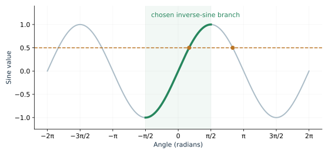
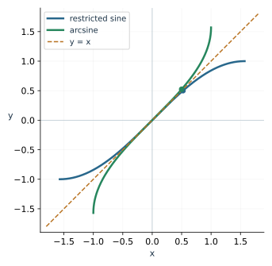
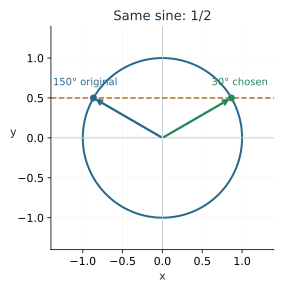
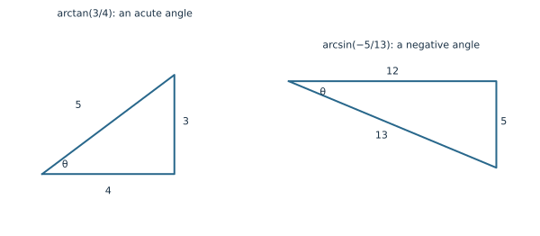
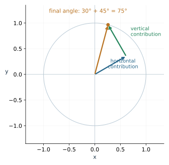

A ladder reaches 12 feet up a wall with its foot 5 feet from the wall. The ratio \(12/5\) tells us the tangent of the ladder's ground angle. How do we recover the angle itself?

An inverse trig function answers that question by choosing an angle with the requested ratio. Because trig functions repeat values, we must understand which angle it chooses. We will then use the geometry of coordinates and rotations to explain identities and calculate new exact values.

## An inverse returns an angle

For the ladder, \(\tan\theta=12/5\), so
\[
\theta=\arctan(12/5)\approx67.4^\circ.
\]
The acute angle supplied by the physical triangle fits the calculator's answer.

The notation \(\tan^{-1}\) on a calculator means inverse tangent, also called arctangent. The inverse sine and cosine functions are written \(\arcsin\) and \(\arccos\).

An inverse function reverses the input-output relationship. For example, \(\sin30^\circ=1/2\). Reversing that relationship gives \(\arcsin(1/2)=30^\circ\). A reciprocal performs a different operation: \(1/\sin30^\circ=2\).

| Expression | What it asks | Result |
|---|---|---|
| \(\arcsin(1/2)\) | Which chosen angle has sine \(1/2\)? | \(\pi/6\) radians |
| \(1/(1/2)\) | What is the reciprocal of \(1/2\)? | \(2\) |
| \(\csc(\pi/6)\) | What is the reciprocal of this angle's sine? | \(2\) |

Always check degree or radian mode when a calculator reports an angle. The same geometric angle can be displayed as \(30^\circ\) or approximately \(0.524\) radians.

## Restrict a repeating function before reversing it

Sine takes the value \(1/2\) at both \(\pi/6\) and \(5\pi/6\), and at infinitely many angles obtained by full turns. A function must return one output for each input, so inverse sine needs a convention that chooses one.

We restrict sine to \([-\pi/2,\pi/2]\). On that interval it rises steadily from \(-1\) to 1 and takes each value exactly once. Reversing this restricted function defines arcsine.

The **principal ranges** specify the choices made by all three inverse functions:

| Inverse function | Allowed inputs | Angle outputs |
|---|---|---|
| \(\arcsin x\) | \([-1,1]\) | \([-\pi/2,\pi/2]\) |
| \(\arccos x\) | \([-1,1]\) | \([0,\pi]\) |
| \(\arctan x\) | All real numbers | \((-\pi/2,\pi/2)\) |

The tangent endpoints are excluded because tangent itself is undefined there. Its restricted branch still reaches every real output, so arctangent accepts every real input.

::: {.example}
**Worked example: choose the angle in the range.** We have
\[
\arcsin(-\sqrt2/2)=-\pi/4,\qquad
\arccos(-1/2)=2\pi/3,\qquad
\arctan(-1)=-\pi/4.
\]
Each output lies in its function's principal range and produces the requested trig value. For example, \(5\pi/4\) also has tangent 1, but \(\arctan(1)=\pi/4\).
:::

The [Inverse Trigonometry Explorer](../demos/inverse_trig.html) compares an original angle with the principal angle. Watch which information is retained when you keep only one trig value.

## Reflect the restricted graph to see its inverse

If \((a,b)\) lies on a function graph, the reversed relationship contains \((b,a)\). Swapping coordinates reflects the graph across \(y=x\).

For sine, use the restricted branch. The point \((\pi/6,1/2)\) becomes \((1/2,\pi/6)\) on arcsine. The old range becomes the new domain, and the old domain becomes the new range.

Use the [Inverse Graphs Explorer](../demos/inverse_trig_graphs.html) to compare all three inverse graphs. Arcsine and arccosine have bounded input intervals. Arctangent accepts all real inputs, while its output approaches the excluded angle endpoints.

**Try it.** Choose the cosine points at \(0,\pi/2,\pi\). Swap their coordinates to obtain three points on arccosine.

## Check the order in a composition

The expression \(\sin(\arcsin u)\) starts with an allowed ratio \(u\), turns it into the chosen angle, then takes that angle's sine. It returns \(u\) for every \(u\in[-1,1]\).

The expression \(\arcsin(\sin\theta)\) starts with an angle. It first keeps only the sine value, then selects an angle in the principal range. It returns the original angle only when that angle already belongs to \([-\pi/2,\pi/2]\).

::: {.example}
**Worked example: two angles share one sine.**
\[
\arcsin(\sin150^\circ)=\arcsin(1/2)=30^\circ.
\]
The original angle is outside the arcsine range. In contrast, \(\arccos(\cos150^\circ)=150^\circ\), since \(150^\circ\) is in arccosine's range.
:::

This distinction will matter when we solve equations in Module 5. An inverse trig function supplies a principal angle; an equation may require every angle producing the same value.

## Use a triangle to evaluate mixed compositions

Consider \(\sin(\arctan(3/4))\). Calling the inside angle \(\theta\) makes the steps easier to see:
\[
\theta=\arctan(3/4)\quad\Longrightarrow\quad\tan\theta=3/4.
\]
Since the ratio is positive and arctangent returns angles between \(-\pi/2\) and \(\pi/2\), this angle is acute. Draw a right triangle with opposite side 3 and adjacent side 4. Its hypotenuse is 5, giving \(\sin\theta=3/5\).

::: {.example}
**Worked example: use the range to choose a sign.** To find \(\cos(\arcsin(-5/13))\), set \(\theta=\arcsin(-5/13)\). Its sine is negative, and its principal angle lies between \(-\pi/2\) and 0. Cosine is positive there:
\[
\cos\theta=\sqrt{1-\sin^2\theta}
=\sqrt{1-\frac{25}{169}}=\frac{12}{13}.
\]
The square-root magnitude alone would leave a sign choice. The principal range resolves it.
:::

**Try it.** Find \(\sin(\arccos(-3/5))\) exactly. Identify the quadrant of the chosen angle before deciding the sign.

## Derive identities from a familiar equation

An identity states that two expressions agree at every input where both are defined. A trig equation such as \(\sin x=1/2\) instead asks which inputs make the statement true.

The unit-circle equation gives our basic identity:
\[
\sin^2x+\cos^2x=1.
\]
Divide every term by \(\cos^2x\), requiring \(\cos x\ne0\):
\[
\frac{\sin^2x}{\cos^2x}+1=\frac1{\cos^2x}
\quad\Longrightarrow\quad
1+\tan^2x=\sec^2x.
\]
Dividing by \(\sin^2x\) similarly gives \(1+\cot^2x=\csc^2x\), where \(\sin x\ne0\).

::: {.example}
**Worked example: simplify while keeping the domain.** For \(\sin x\ne0\),
\[
\frac{1-\cos^2x}{\sin x}
=\frac{\sin^2x}{\sin x}=\sin x.
\]
The final expression exists at more inputs than the original quotient. Our identity retains the original restriction \(x\ne k\pi\).
:::

To prove an identity, start with one expression and use established algebraic or trigonometric relationships until you obtain the other. Record any denominator restrictions. Numerical agreement at a few angles helps check your work, but a proof must cover the whole stated domain.

## Read symmetry identities from the circle

Reflecting a point across the horizontal axis preserves its horizontal coordinate and reverses its vertical coordinate. Therefore
\[
\cos(-x)=\cos x,\qquad \sin(-x)=-\sin x.
\]
Cosine is even and sine is odd. Their quotient gives \(\tan(-x)=-\tan x\) wherever tangent is defined.

A half-turn negates both coordinates:
\[
\cos(x+\pi)=-\cos x,\qquad
\sin(x+\pi)=-\sin x.
\]
For example, \(\sin(-7\pi/6)=-\sin(7\pi/6)=1/2\), while \(\cos(-7\pi/6)=\cos(7\pi/6)=-\sqrt3/2\).

## Combine two rotations to derive addition formulas

An initial turn of \(\beta\) gives the point \((\cos\beta,\sin\beta)\). Now rotate that entire configuration by another angle \(\alpha\).

The original horizontal unit direction turns to \((\cos\alpha,\sin\alpha)\). The original vertical unit direction, a quarter-turn farther around, turns to \((-\sin\alpha,\cos\alpha)\).

The point's horizontal contribution has length \(\cos\beta\) along the first direction. Its vertical contribution has length \(\sin\beta\) along the second. Add their coordinate contributions:
\[
\begin{aligned}
x&=\cos\beta\cos\alpha-\sin\beta\sin\alpha,\\
y&=\cos\beta\sin\alpha+\sin\beta\cos\alpha.
\end{aligned}
\]
The final point also has angle \(\alpha+\beta\). Its coordinates are cosine and sine of that total angle.

Consequently,
\[
\begin{aligned}
\cos(\alpha+\beta)&=\cos\alpha\cos\beta-\sin\alpha\sin\beta,\\
\sin(\alpha+\beta)&=\sin\alpha\cos\beta+\cos\alpha\sin\beta.
\end{aligned}
\]
Replacing \(\beta\) by \(-\beta\) and using symmetry gives the difference formulas:
\[
\begin{aligned}
\cos(\alpha-\beta)&=\cos\alpha\cos\beta+\sin\alpha\sin\beta,\\
\sin(\alpha-\beta)&=\sin\alpha\cos\beta-\cos\alpha\sin\beta.
\end{aligned}
\]

::: {.example}
**Worked example: an exact value at a new angle.** Write \(75^\circ=45^\circ+30^\circ\). Then
\[
\sin75^\circ
=\frac{\sqrt2}{2}\frac{\sqrt3}{2}
+\frac{\sqrt2}{2}\frac12
=\frac{\sqrt6+\sqrt2}{4}.
\]
Similarly, \(\cos75^\circ=(\sqrt6-\sqrt2)/4\). Both are positive, as expected in Quadrant I.
:::

The formulas explain why \(\sin(a+b)\) generally differs from \(\sin a+\sin b\). Each original coordinate contributes to both final coordinates after rotation.

## Double angles, squared functions, and half angles

Set both angles equal to \(x\):
\[
\sin2x=2\sin x\cos x,\qquad
\cos2x=\cos^2x-\sin^2x.
\]
Using the Pythagorean identity gives two more cosine forms:
\[
\cos2x=1-2\sin^2x=2\cos^2x-1.
\]
Choose the form containing the quantities you already know.

Rearranging produces the power-reduction identities
\[
\sin^2x=\frac{1-\cos2x}{2},\qquad
\cos^2x=\frac{1+\cos2x}{2}.
\]
Replacing \(x\) by \(\theta/2\) gives the squared half-angle values. Taking square roots requires the sign from the half-angle's quadrant. For instance, \(15^\circ\) is acute, so
\[
\cos15^\circ=\sqrt{\frac{1+\cos30^\circ}{2}}
=\frac{\sqrt{2+\sqrt3}}{2}.
\]
This equals \((\sqrt6+\sqrt2)/4\), the form obtained from the cosine difference identity.

**Try it.** Use angle addition to find \(\sin105^\circ\). Then find \(\cos2x\) using \(\sin x\) alone.

## Review exercises

1. Evaluate \(\arcsin(-\sqrt2/2)\) and \(\arctan(\sqrt3)\) exactly.
2. Explain the output of \(\arcsin(\sin(3\pi/4))\).
3. Find \(\cos(\arcsin(5/13))\) using a triangle.
4. Find \(\sin(\arctan(-2))\), including its sign.
5. Prove \((\sec^2x-1)/\tan x=\tan x\) on its domain.
6. Prove \((\sin x+\cos x)^2=1+\sin2x\).
7. Calculate \(\cos75^\circ\) exactly.
8. Express \(\cos2x\) using sine alone.
9. State and explain the domain and range of arccosine.
10. Evaluate \(\arccos(\cos(5\pi/3))\).
11. Find \(\tan(\arccos(4/5))\) exactly.
12. Use circle symmetry to find \(\sin(-\pi/3)\).
13. Derive the cosine difference identity from the sum identity.
14. Prove \(\cos^2x=(1+\cos2x)/2\).
15. Find \(\sin15^\circ\) exactly and state its sign.
16. Explain the output of \(\arctan(\tan(3\pi/4))\).

## Check your understanding

The reflected cosine points are \((1,0),(0,\pi/2),(-1,\pi)\). For the mixed composition, arccosine selects a Quadrant II angle, so \(\sin(\arccos(-3/5))=4/5\).

The addition calculation gives \(\sin105^\circ=(\sqrt6+\sqrt2)/4\), positive in Quadrant II. The requested double-angle form is \(\cos2x=1-2\sin^2x\).
