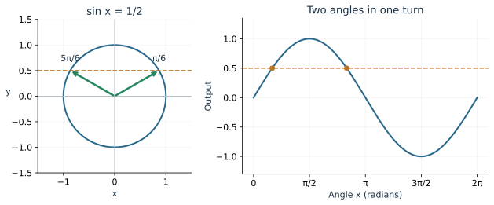
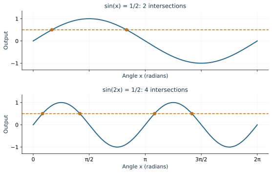
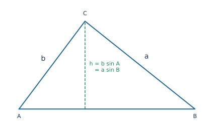
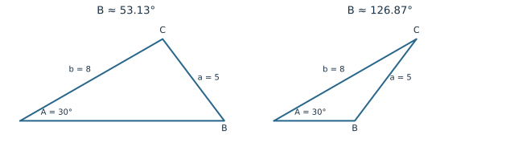

An inverse trig button gives an angle. An equation can ask for several angles, or for an entire repeating family. The difference comes from the geometry we have been studying: a rotating point can return to the same height or horizontal position more than once.

We will use that picture to solve equations, then use the same trigonometric relationships to find distances in triangles. Keep a sketch beside your algebra. It helps you decide how many answers to expect and whether your answers fit the situation.

## Find the angles that give a chosen height

Consider \(\sin x=\tfrac12\). Sine is the vertical coordinate on the unit circle, so we want every point on the circle whose height is \(\tfrac12\). A horizontal line at that height meets the circle twice. The angles are \(\pi/6\) and \(5\pi/6\).

On the interval \(0\le x<2\pi\), those are the two answers. The left endpoint is included; the right endpoint is excluded. That choice represents one complete turn without counting its starting position twice.

If the question asks for **all real solutions**, each angle may be followed by any whole number of turns:

\[
x=\frac{\pi}{6}+2\pi k
\quad\text{or}\quad
x=\frac{5\pi}{6}+2\pi k,\qquad k\in\mathbb Z.
\]

The integer \(k\) includes turns in either direction. For example, \(k=-1\) gives negative angles that reach the same two points.

::: {.example}
**Worked example: a negative horizontal coordinate.** Solve \(\cos x=-\sqrt2/2\) on \([0,2\pi)\). The reference angle is \(\pi/4\). Cosine is negative on the left half of the circle, in Quadrants II and III. Therefore
\[
x=\pi-\frac{\pi}{4}=\frac{3\pi}{4},
\qquad
x=\pi+\frac{\pi}{4}=\frac{5\pi}{4}.
\]
Both answers give the requested horizontal coordinate.
:::

For tangent, a half-turn restores the same slope. Thus \(\tan x=-1\) has the family \(x=-\pi/4+k\pi\). On \([0,2\pi)\), the two members of that family are \(3\pi/4\) and \(7\pi/4\).

**Try it.** Solve \(\sin x=-\sqrt3/2\) on \([0,2\pi)\). Mark the two points before writing their angles.

## Solve for the whole inside angle

In \(\sin(2x)=\sqrt3/2\), the input to sine is \(2x\). Call that input \(u\). As \(x\) runs through \([0,2\pi)\), the angle \(u=2x\) runs through \([0,4\pi)\). We must search two turns.

On the first turn, \(u=\pi/3\) or \(2\pi/3\). Add \(2\pi\) to get the second-turn answers \(7\pi/3\) and \(8\pi/3\). Now divide **each** by 2:

\[
x=\frac{\pi}{6},\quad \frac{\pi}{3},\quad
\frac{7\pi}{6},\quad \frac{4\pi}{3}.
\]

The graph provides a useful count: \(\sin(2x)\) completes two cycles on this interval, and the chosen positive height occurs twice per cycle. We expect four solutions. At a maximum or minimum there is just one intersection per cycle; a target outside \([-1,1]\) gives none.

::: {.example}
**Worked example: a shifted inside angle.** Solve \(\sin(x-\pi/4)=1/2\) on \([0,2\pi)\). Set \(u=x-\pi/4\); its interval is \([-\pi/4,7\pi/4)\). In that interval, \(u=\pi/6\) or \(5\pi/6\). Adding \(\pi/4\) gives
\[
x=\frac{5\pi}{12}\quad\text{or}\quad\frac{13\pi}{12}.
\]
Substituting either answer restores one of the two familiar sine angles.
:::

Use the [Equation Explorer](../demos/trig_equations.html) to compare frequencies 1, 2, and 3. Predict the number of intersections before displaying them.

## Let algebra organize the choices

Start an equation such as \(2\cos x-1=0\) by isolating its trig expression. We obtain \(\cos x=1/2\), then use the circle to find \(x=\pi/3,5\pi/3\) on one turn.

Equations that are quadratic in a trig expression can be factored just as quadratics in an ordinary variable:

\[
2\sin^2x-\sin x=0
\quad\Longrightarrow\quad
\sin x(2\sin x-1)=0.
\]

The zero-product rule gives two branches:

\[
\sin x=0
\quad\text{or}\quad
\sin x=\frac12.
\]

The first branch contributes \(0,\pi\); the second contributes \(\pi/6,5\pi/6\). There are four distinct solutions on \([0,2\pi)\). Dividing the original equation by \(\sin x\) would remove the first branch. Factoring keeps it visible.

An identity can also reveal a familiar equation. For \(2\cos^2x-1=0\), we get \(\cos x=\pm\sqrt2/2\). Each sign contributes two angles. When you use a quotient, reciprocal, or division, keep track of inputs excluded from the original expression. Check your final angles in that original expression.

**Try it.** Solve \(2\cos^2x-\cos x=0\) on \([0,2\pi)\). First write the two equations produced by factoring.

## Label a triangle before choosing a law

For any triangle, use capital letters \(A,B,C\) for angles and the corresponding lowercase letters \(a,b,c\) for the sides **opposite** them. Angle \(A\) and side \(a\) are separated across the triangle. Angles add to \(180^\circ\), or \(\pi\) radians.

Right-triangle ratios use an opposite side, adjacent side, and hypotenuse. For a triangle with no right angle, we need relationships that work without a hypotenuse.

In the pictured triangle, the altitude has height \(h=b\sin A=a\sin B\). Equating these expressions and rearranging gives \(a/\sin A=b/\sin B\). The same reasoning with another altitude gives the **Law of Sines**:

\[
\frac{a}{\sin A}=\frac{b}{\sin B}=\frac{c}{\sin C}.
\]

It is especially useful when an angle and its opposite side are both known. That complete pair supplies a ratio to compare with another pair.

::: {.example}
**Worked example: two angles and a side.** Suppose \(A=40^\circ\), \(B=65^\circ\), and \(a=9\) cm. First find \(C=180^\circ-40^\circ-65^\circ=75^\circ\). Pair \(a\) with \(A\), and \(b\) with \(B\):
\[
\frac{b}{\sin65^\circ}=\frac{9}{\sin40^\circ},
\qquad
b=\frac{9\sin65^\circ}{\sin40^\circ}\approx12.69\text{ cm}.
\]
The larger angle \(65^\circ\) faces the longer side, which agrees with the result. Use degree mode for these measurements.
:::

## Why two triangles can fit the same measurements

Suppose \(A=30^\circ\), \(a=5\), and \(b=8\). The known angle is opposite the side of length 5. The Law of Sines gives

\[
\sin B=\frac{b\sin A}{a}
=\frac{8\sin30^\circ}{5}=0.8.
\]

The calculator gives \(B_1=\arcsin(0.8)\approx53.13^\circ\). Sine also has that value at its supplement, \(B_2=180^\circ-B_1\approx126.87^\circ\). Check each candidate against the angle sum:

\[
C_1\approx96.87^\circ,\qquad C_2\approx23.13^\circ.
\]

Both remaining angles are positive, so both triangles work.

This is the **ambiguous SSA case**: two sides and a nonincluded angle are given. Follow three checks. If the calculated sine exceeds 1, no triangle exists. Otherwise find the principal angle and its supplement. Keep only distinct candidates for which \(A+B<180^\circ\). Depending on the measurements, zero, one, or two triangles survive.

For example, changing \(a\) to 3 gives \(\sin B=4/3\), so there is no triangle. Changing \(a\) to 8 gives candidates \(30^\circ\) and \(150^\circ\); the latter leaves \(C=0^\circ\), so only the first is a triangle.

## Use the included angle with the Law of Cosines

If two sides and the angle **between** them are known, there is no complete opposite side-angle pair. The **Law of Cosines** supplies the missing side:

\[
c^2=a^2+b^2-2ab\cos C.
\]

To see where it comes from, place angle \(C\) at the origin. One endpoint is \((b,0)\), and the other is \((a\cos C,a\sin C)\). Their squared distance is

\[
\begin{aligned}
c^2&=(a\cos C-b)^2+(a\sin C)^2\\
&=a^2(\cos^2C+\sin^2C)+b^2-2ab\cos C.
\end{aligned}
\]

The Pythagorean identity reduces the first term to \(a^2\).

::: {.example}
**Worked example: a connector between two roads.** Two roads extend 7 km and 10 km from a junction, separated by \(60^\circ\). The connector between their endpoints has length
\[
c=\sqrt{7^2+10^2-2(7)(10)\cos60^\circ}
=\sqrt{79}\approx8.89\text{ km}.
\]
At \(90^\circ\), the cosine term is zero and the formula becomes the Pythagorean theorem. For the same side lengths, a wider included angle produces a longer connector.
:::

If all three sides are known, rearrange the law to recover an angle:
\[
C=\arccos\left(\frac{a^2+b^2-c^2}{2ab}\right).
\]
The geometric angle lies between \(0^\circ\) and \(180^\circ\), which matches the range of arccosine.

## Choose a method and interpret the result

For an equation, decide which interval to search, solve for the trig expression, and use periodicity to find every answer. For a triangle, draw and label the known measurements. A complete opposite pair suggests the Law of Sines; two sides with their included angle, or three sides, suggest the Law of Cosines.

A shoreline survey illustrates the choice. Two observers stand 200 m apart and measure interior sight angles of \(47^\circ\) and \(68^\circ\) to an island marker. The third angle is \(65^\circ\). The known baseline is opposite that angle, so it supplies the complete pair for the Law of Sines. The geometry tells us which measurements belong together before we calculate.

## Review exercises

1. Solve \(\sin x=-\sqrt3/2\) on \([0,2\pi)\), then write all real solutions.
2. Solve \(2\sin(3x)=1\) on \([0,2\pi)\). Explain the number of answers.
3. Solve \(2\cos^2x-\cos x=0\) on \([0,2\pi)\).
4. Solve \(\tan x=-1\) for all real \(x\).
5. Solve \(\cos(2x)=1/2\) on \([0,2\pi)\).
6. A triangle has \(A=35^\circ\), \(B=80^\circ\), \(a=12\). Find \(C\) and \(b\).
7. For \(A=30^\circ\), \(a=5\), \(b=8\), find both possible values of \(C\).
8. Find the third side for sides 6 and 9 with included angle \(120^\circ\).
9. Explain how the Law of Cosines includes the Pythagorean theorem.
10. Solve \(\sin(x-\pi/6)=1/2\) on \([0,2\pi)\).

## Check your understanding

The first Try it has answers \(4\pi/3,5\pi/3\). For the factoring Try it, \(\cos x=0\) or \(\cos x=1/2\), giving \(\pi/2,3\pi/2,\pi/3,5\pi/3\). Each branch contributes its own angles. A sketch or a substitution checks the result.
