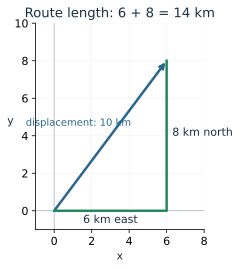
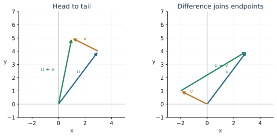
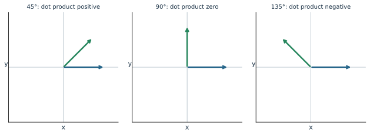
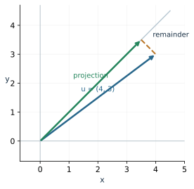

A person walks 6 km east, then 8 km north. The route is 14 km long, but the endpoint is only 10 km from the start. To describe where the person ends up, we need both a distance and a direction. A vector records those two pieces of information together.

This chapter develops vectors from familiar coordinates and triangle geometry. We will add movements, resolve forces into components, and measure how much one vector points along another.

## Describe a displacement with components

The displacement \(\mathbf u=\langle6,8\rangle\) means 6 units horizontally and 8 units vertically. Angle brackets distinguish a vector from a location \((6,8)\). The same components can describe an arrow starting anywhere in the plane.

For a vector \(\mathbf u=\langle u_x,u_y\rangle\), its **magnitude** is the length of its arrow:
\[
\|\mathbf u\|=\sqrt{u_x^2+u_y^2}.
\]
For the walk, \(\sqrt{6^2+8^2}=10\) km. This is displacement magnitude. The distance walked depends on the route.

To find the vector from \(P=(p_x,p_y)\) to \(Q=(q_x,q_y)\), subtract start from finish:
\[
\overrightarrow{PQ}=\langle q_x-p_x,q_y-p_y\rangle.
\]
Starting at \(P\), adding those two changes lands exactly at \(Q\).

::: {.example}
**Worked example: from one location to another.** For \(P=(-2,3)\), \(Q=(5,-1)\),
\[
\overrightarrow{PQ}=\langle5-(-2),-1-3\rangle=\langle7,-4\rangle,
\qquad \|\overrightarrow{PQ}\|=\sqrt{65}.
\]
The endpoint lies 7 units right and 4 units down from the start. Reversing the journey gives \(\overrightarrow{QP}=\langle-7,4\rangle\).
:::

## Add arrows by following one with another

If a movement \(\mathbf u\) is followed by \(\mathbf v\), the total horizontal change is \(u_x+v_x\), and the total vertical change is \(u_y+v_y\):
\[
\mathbf u+\mathbf v=\langle u_x+v_x,u_y+v_y\rangle.
\]
Draw the second arrow with its tail at the first arrow's head. The sum joins the original start to the final endpoint. Translating an arrow for this construction preserves its components.

For \(\mathbf u=\langle3,4\rangle\) and \(\mathbf v=\langle-2,1\rangle\), the sum is \(\langle1,5\rangle\). The second movement goes left by 2 and up by 1. Adding it reduces the eastward component and increases the northward component.

Multiplying by a number scales every component:
\[
c\mathbf u=\langle cu_x,cu_y\rangle.
\]
For \(c>0\), the arrow keeps its direction; for \(c<0\), it reverses direction. Its length becomes \(|c|\|\mathbf u\|\). The zero vector \(\langle0,0\rangle\) has magnitude zero and has no direction.

Subtraction means adding the opposite: \(\mathbf u-\mathbf v=\mathbf u+(-\mathbf v)\). If both vectors start at the origin, \(\mathbf u-\mathbf v\) points from the endpoint of \(\mathbf v\) to the endpoint of \(\mathbf u\).

**Try it.** With \(\mathbf u=\langle2,5\rangle\), \(\mathbf v=\langle-1,3\rangle\), calculate \(\mathbf u+\mathbf v\) and \(3\mathbf u-2\mathbf v\). Check the direction of each component.

## Convert between length-and-angle and components

A vector of magnitude \(r\ge0\) at angle \(\theta\), measured counterclockwise from the positive horizontal axis, has components
\[
\mathbf u=\langle r\cos\theta,r\sin\theta\rangle.
\]
This is the unit-circle point scaled by \(r\). The magnitude returns to \(r\), because \(\cos^2\theta+\sin^2\theta=1\).

::: {.example}
**Worked example: a force pointing up and left.** A 20 N force acts at \(150^\circ\):
\[
\mathbf F=\langle20\cos150^\circ,20\sin150^\circ\rangle
=\langle-10\sqrt3,10\rangle\text{ N}.
\]
The negative horizontal component describes the leftward part of the force; the positive vertical component describes its upward part.
:::

For a vector with known components, find the magnitude first. To recover direction, inspect the quadrant before using inverse tangent. For \(\langle-3,4\rangle\), the reference angle is \(\arctan(4/3)\approx53.13^\circ\). The vector lies in Quadrant II, so its direction is \(180^\circ-53.13^\circ=126.87^\circ\). The single quotient \(4/(-3)\) does not by itself specify that quadrant.

A **unit vector** has magnitude 1. For a nonzero vector,
\[
\widehat{\mathbf u}=\frac{\mathbf u}{\|\mathbf u\|}.
\]
Thus \(\langle-3,4\rangle/5=\langle-3/5,4/5\rangle\) keeps the direction and sets the length to 1.

## The dot product measures alignment

The dot product combines two vectors into a number:
\[
\mathbf u\cdot\mathbf v=u_xv_x+u_yv_y.
\]
For nonzero vectors, this number also has a geometric form:
\[
\mathbf u\cdot\mathbf v=\|\mathbf u\|\|\mathbf v\|\cos\phi,
\]
where \(0\le\phi\le\pi\) is the angle between their arrows.

The sign has meaning. Positive indicates an acute angle, zero indicates a right angle, and negative indicates an obtuse angle. A zero vector has dot product zero with every vector, but there is no angle to assign to it.

::: {.example}
**Worked example: perpendicular vectors.** Let \(\mathbf u=\langle3,4\rangle\), \(\mathbf v=\langle4,-3\rangle\). Their dot product is \(12-12=0\). Both are nonzero, so the angle between them is \(90^\circ\).
:::

To calculate another angle, solve the geometric formula:
\[
\phi=\arccos\left(\frac{\mathbf u\cdot\mathbf v}
{\|\mathbf u\|\|\mathbf v\|}\right).
\]
For \(\langle2,1\rangle\) and \(\langle1,2\rangle\), the dot product is 4 and each magnitude is \(\sqrt5\). Thus \(\phi=\arccos(4/5)\approx36.87^\circ\).

## A projection is the part pointing along a chosen direction

Imagine a light casting an arrow's shadow onto a line through the origin. The **projection** records the part of \(\mathbf u\) along the direction of a nonzero vector \(\mathbf v\):
\[
\operatorname{proj}_{\mathbf v}\mathbf u
=\frac{\mathbf u\cdot\mathbf v}{\|\mathbf v\|^2}\mathbf v.
\]

Why this coefficient? First divide \(\mathbf v\) by its length to get a unit direction \(\widehat{\mathbf v}\). The signed length of the shadow is \(\mathbf u\cdot\widehat{\mathbf v}=\|\mathbf u\|\cos\phi\). Multiply that length by \(\widehat{\mathbf v}\), obtaining the displayed vector formula.

::: {.example}
**Worked example: horizontal and slanted projections.** Projecting \(\langle4,3\rangle\) onto \(\langle1,0\rangle\) gives \(\langle4,0\rangle\). Onto \(\mathbf v=\langle1,1\rangle\), the coefficient is \((4+3)/(1+1)=7/2\), giving \(\langle7/2,7/2\rangle\). The remainder is \(\langle1/2,-1/2\rangle\); its dot product with \(\langle1,1\rangle\) is zero.
:::

## Work uses the force along the displacement

For a constant force \(\mathbf F\) acting through displacement \(\mathbf d\), the work is
\[
W=\mathbf F\cdot\mathbf d
=\|\mathbf F\|\|\mathbf d\|\cos\phi.
\]
Newtons times meters give joules. A perpendicular force contributes zero work to that displacement. A force pointing against the displacement contributes negative work.

A force \(\langle12,5\rangle\) N acting through \(\langle3,0\rangle\) m does \(12(3)+5(0)=36\) J of work. Only the horizontal component contributes. If the force instead acted at \(60^\circ\) to the displacement, only half its magnitude would act along the movement.

**Try it.** A 50 N force acts at \(60^\circ\) to a 4 m displacement. Calculate its work and compare with the work from a parallel force of the same magnitude.

## The triangle law returns in vector language

Place two vectors \(\mathbf u,\mathbf v\) at a common starting point. Their difference joins their endpoints. Expanding its squared magnitude gives
\[
\begin{aligned}
\|\mathbf u-\mathbf v\|^2
&=(\mathbf u-\mathbf v)\cdot(\mathbf u-\mathbf v)\\
&=\|\mathbf u\|^2+\|\mathbf v\|^2-2\mathbf u\cdot\mathbf v\\
&=\|\mathbf u\|^2+\|\mathbf v\|^2
-2\|\mathbf u\|\|\mathbf v\|\cos\phi.
\end{aligned}
\]
This is the Law of Cosines. The sides are the two original vectors and their connecting difference. It explains why component calculations and triangle calculations agree.

Use the [Vector Explorer](../demos/vector_explorer.html) to compare the picture with the component arithmetic. When you change one component, describe the movement of the endpoint before reading the new magnitude or dot product.

## Review exercises

1. Find the vector from \((-2,3)\) to \((5,-1)\), and its magnitude.
2. For \(\mathbf u=\langle2,5\rangle\), \(\mathbf v=\langle-1,3\rangle\), compute \(\mathbf u+\mathbf v\) and \(3\mathbf u-2\mathbf v\).
3. Find exact components of a displacement of magnitude 12 at \(150^\circ\).
4. Find a unit vector in the direction \(\langle-3,4\rangle\).
5. Compute \(\langle2,-1\rangle\cdot\langle5,3\rangle\) and interpret its sign.
6. Determine whether \(\langle6,2\rangle\) and \(\langle-1,3\rangle\) are perpendicular.
7. Find the projection of \(\langle4,3\rangle\) onto \(\langle1,0\rangle\).
8. Find the work of a 50 N force acting at \(60^\circ\) to a 4 m displacement.
9. Find the angle between \(\langle1,0\rangle\) and \(\langle1,\sqrt3\rangle\).
10. Give two routes with the same displacement but different total distances.

## Check your understanding

The first Try it gives \(\langle1,8\rangle\) and \(\langle8,9\rangle\). The work example gives \(50(4)\cos60^\circ=100\) J, compared with 200 J for a parallel force. The factor \(\cos60^\circ=1/2\) measures the contributing part of the force.
