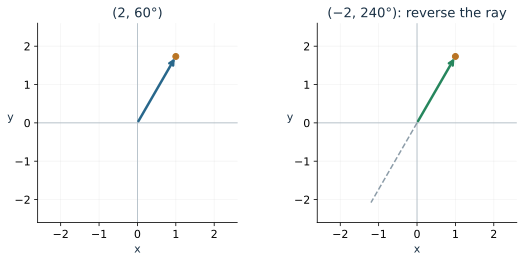
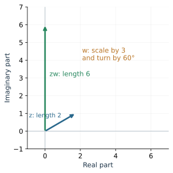
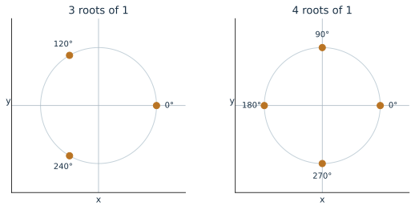
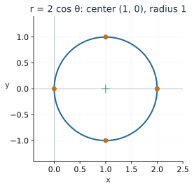

An address such as \((3,4)\) describes a point by moving horizontally and vertically. A distance of 5 at a direction of about \(53^\circ\) describes the same point by aiming and traveling. Polar coordinates use that second description.

Complex numbers will add another interpretation. They represent points in the plane, and their multiplication performs rotations and scaling. The trigonometry from earlier chapters explains why.

## Locate a point by distance and direction

A polar pair \((r,\theta)\) gives a radius and an angle from the positive horizontal axis. For \(r>0\), start along the ray at angle \(\theta\) and travel \(r\) units from the origin. The familiar circle coordinates give
\[
x=r\cos\theta,\qquad y=r\sin\theta.
\]
These are the same component formulas used for vectors. Here they locate a point.

::: {.example}
**Worked example: a point in Quadrant II.** For \((r,\theta)=(4,5\pi/6)\),
\[
x=4(-\sqrt3/2)=-2\sqrt3,\qquad y=4(1/2)=2.
\]
The negative \(x\) and positive \(y\) agree with the angle's quadrant. The point is 4 units from the origin.
:::

To go in the other direction with \(r\ge0\), use \(r=\sqrt{x^2+y^2}\). Find the angle from both coordinate signs. For \((-3,-3)\), the distance is \(3\sqrt2\), and the direction is \(5\pi/4\) on \([0,2\pi)\). Computing \(\arctan(y/x)=\pi/4\) alone would place the point in the wrong quadrant.

**Try it.** Convert \((6,-\pi/3)\) to Cartesian coordinates. Give the same direction using an angle between 0 and \(2\pi\).

## Several polar addresses can name one point

Adding a full turn changes an angle's description while leaving its direction fixed:
\[
(r,\theta)\quad\text{and}\quad(r,\theta+2\pi k)
\]
represent the same point for every integer \(k\).

A negative radius means travel in the direction opposite the chosen ray. Consequently,
\[
(r,\theta)\quad\text{and}\quad(-r,\theta+\pi)
\]
also represent the same point.

For example, \((2,\pi/3)\), \((2,7\pi/3)\), and \((-2,4\pi/3)\) all locate \((1,\sqrt3)\). Check the last address directly: both cosine and sine at \(4\pi/3\) are negative, and multiplying by \(-2\) makes the coordinates positive.

At \(r=0\), all choices of angle locate the origin. This redundancy is part of the coordinate system. A unique polar address requires conventions about radius and angle.

## Put complex numbers on the plane

A complex number \(z=a+bi\), where \(i^2=-1\), corresponds to the point \((a,b)\). The horizontal axis records its real part \(a\), and the vertical axis its imaginary part \(b\).

Its **modulus** is its distance from zero:
\[
|z|=\sqrt{a^2+b^2}.
\]
For \(z\ne0\), an **argument** is an angle locating its direction. Polar form writes
\[
z=r(\cos\theta+i\sin\theta),\qquad r=|z|.
\]
Arguments differ by whole turns. The number zero has modulus zero and no defined argument.

::: {.example}
**Worked example: rectangular to polar form.** For \(z=-\sqrt3+i\), the modulus is \(\sqrt{3+1}=2\). The point lies in Quadrant II with reference angle \(\pi/6\), so one argument is \(5\pi/6\):
\[
z=2\left(\cos\frac{5\pi}{6}+i\sin\frac{5\pi}{6}\right).
\]
Multiplying out the two components returns the original number.
:::

## Addition combines components; multiplication combines transformations

Complex addition follows vector addition:
\[
(a+bi)+(c+di)=(a+c)+(b+d)i.
\]
For multiplication, expand and use \(i^2=-1\):
\[
(a+bi)(c+di)=(ac-bd)+(ad+bc)i.
\]
For example, \((1+i)(1-i)=1-i^2=2\), while \((1+i)+(1-i)=2\) as well. These particular results agree, but the two operations follow different rules.

To see the geometric rule for multiplication, write
\[
z=r(\cos\alpha+i\sin\alpha),\qquad
w=s(\cos\beta+i\sin\beta).
\]
Expanding gives real part \(rs(\cos\alpha\cos\beta-\sin\alpha\sin\beta)\) and imaginary part \(rs(\sin\alpha\cos\beta+\cos\alpha\sin\beta)\). The angle-addition identities turn these into
\[
zw=rs\bigl(\cos(\alpha+\beta)+i\sin(\alpha+\beta)\bigr).
\]
**Multiply the moduli and add the arguments.**

::: {.example}
**Worked example: rotate and stretch.** Suppose \(z\) has modulus 2 and argument \(30^\circ\), while \(w\) has modulus 3 and argument \(60^\circ\). Then \(zw\) has modulus 6 and argument \(90^\circ\), so \(zw=6i\).
:::

Multiplication by \(i\) gives a quarter-turn counterclockwise: \(i(a+bi)=-b+ai\), so \((a,b)\) becomes \((-b,a)\). Its length stays fixed. Multiplication by \(-1\) gives a half-turn. Multiplication by a positive real number changes length while keeping direction.

Use the [Polar and Complex Explorer](../demos/polar_complex.html) to predict a product's length and direction before displaying its rectangular coordinates.

## Powers repeat the same rotation and scaling

Raising a number to a positive integer power repeats its multiplication rule:
\[
\bigl[r(\cos\theta+i\sin\theta)\bigr]^n
=r^n(\cos n\theta+i\sin n\theta).
\]
This is **De Moivre's theorem**. It also holds for zero and negative integer powers when the original number is nonzero.

For example, \((\cos(\pi/6)+i\sin(\pi/6))^3\) has modulus 1 and angle \(\pi/2\), so it equals \(i\). The exponent multiplies the original angle by 3.

To find roots, reverse those two changes. Suppose
\[
z^n=R(\cos\phi+i\sin\phi),\qquad R>0.
\]
The root modulus is \(R^{1/n}\). For the angles, include all complete turns before dividing:
\[
\theta_k=\frac{\phi+2\pi k}{n},\qquad k=0,1,\ldots,n-1.
\]
The roots are equally spaced around a circle.

::: {.example}
**Worked example: three cube roots of 1.** Use \(R=1,\phi=0,n=3\). The angles are \(0,2\pi/3,4\pi/3\), giving
\[
1,\qquad-\frac12+\frac{\sqrt3}{2}i,\qquad
-\frac12-\frac{\sqrt3}{2}i.
\]
Cubing any of these multiplies its angle by 3, producing a whole number of turns.
:::

For the four fourth roots of 1, the angles are \(0,\pi/2,\pi,3\pi/2\), giving \(1,i,-1,-i\).

**Try it.** Find all square roots of \(4i\). Begin with modulus 4 and argument \(\pi/2\).

## A polar equation draws points by changing the radius

In a polar equation such as \(r=2\cos\theta\), each angle supplies a radius. Compute a few pairs, convert them to points, and look for the curve. When the formula supplies a negative radius, reverse the ray as described earlier.

Algebra identifies this particular curve. Multiply by \(r\), then use \(r^2=x^2+y^2\) and \(r\cos\theta=x\):
\[
r=2\cos\theta
\ \Longrightarrow\
x^2+y^2=2x
\ \Longrightarrow\
(x-1)^2+y^2=1.
\]
It is a circle with center \((1,0)\) and radius 1. Multiplying by \(r\) deserves a check at \(r=0\); here the origin belongs to the original curve, since \(\cos\theta=0\) for suitable angles.

The curve is traced once as \(\theta\) runs from 0 to \(\pi\). From \(\pi/2\) onward, the radius is negative, but the resulting points continue around the lower half of the same circle.

## Review exercises

1. Convert \((5,2\pi/3)\) to Cartesian coordinates.
2. Give two distinct polar representations of \((\sqrt2,\sqrt2)\), including one with negative radius.
3. Write \(-1-\sqrt3i\) in polar form with argument in \([0,2\pi)\).
4. Calculate \((2+i)(1-3i)\) in rectangular form.
5. Describe multiplication by \(-i\) geometrically.
6. Evaluate \((\cos(\pi/4)+i\sin(\pi/4))^4\).
7. Find and plot all three cube roots of 1.
8. Convert \(r=4\sin\theta\) to Cartesian form and identify the curve.
9. Find all square roots of \(-9\).
10. Explain what happens to modulus and argument when a nonzero complex number is squared.

## Check your understanding

The first Try it gives \((3,-3\sqrt3)\), with positive angle \(5\pi/3\). The square roots of \(4i\) have modulus 2 and arguments \(\pi/4,5\pi/4\); in rectangular form they are \(\sqrt2+\sqrt2i\) and \(-\sqrt2-\sqrt2i\).
