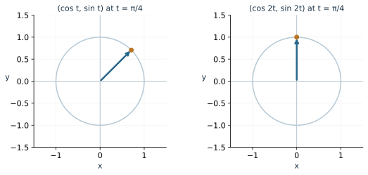
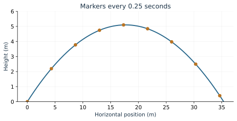
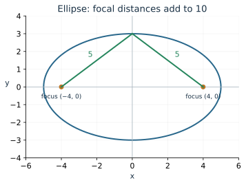
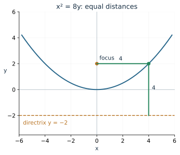
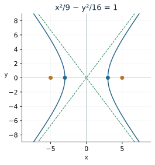

A curve shows where a moving object can go. To describe its motion, we also need to know where it is at each time. Parametric equations supply that information by letting both coordinates depend on one parameter.

We will use moving points to understand curves, then examine the distance rules defining circles, ellipses, parabolas, and hyperbolas. These are different ways to describe the same geometric objects.

## Let two coordinates depend on one input

A parametric curve has the form
\[
x=f(t),\qquad y=g(t).
\]
Choose a value of \(t\), calculate both coordinates, and plot their ordered pair. If \(t\) represents time, that pair is a position at that instant.

For \(x=t+2,\ y=3t-1\), the values \(t=-1,0,1\) give \((1,-4),(2,-1),(3,2)\). The point moves right and up as \(t\) increases. Solving \(t=x-2\) and substituting gives \(y=3x-7\), so the path is a line.

**Eliminating the parameter** means finding an equation involving only \(x\) and \(y\). Keep the original interval for \(t\) in mind. For \(0\le t\le1\), the preceding equations trace only the segment from \((2,-1)\) to \((3,2)\).

## The same curve can carry different motions

For \(x=\cos t,\ y=\sin t\), the point moves counterclockwise around the unit circle. At \(t=0\) it is \((1,0)\); at \(t=\pi/2\) it reaches \((0,1)\).

Replace \(t\) by \(2t\). The point still lies on the unit circle, because \(\cos^2(2t)+\sin^2(2t)=1\). It now completes a revolution in \(\pi\) units of time.

On \(0\le t\le2\pi\), \((\cos t,\sin t)\) travels around once, while \((\cos2t,\sin2t)\) travels twice. Replacing \(t\) by \(-t\) reverses the direction. The Cartesian equation \(x^2+y^2=1\) describes all three paths, but contains no timing information.

::: {.example}
**Worked example: eliminate a trig parameter.** Suppose
\[
x=4\cos t,\qquad y=3\sin t.
\]
Divide by the two scale factors, square, and add:
\[
\left(\frac{x}{4}\right)^2+\left(\frac{y}{3}\right)^2
=\cos^2t+\sin^2t=1.
\]
Thus the curve is \(x^2/16+y^2/9=1\). A full turn of \(t\) traces the whole ellipse; \(0\le t\le\pi\) traces its upper half.
:::

**Try it.** Eliminate \(t\) from \(x=2t+1,\ y=t-3\), with \(0\le t\le4\). Give both the line equation and the endpoints of the traced segment.

## Follow a projectile with two equations

In an idealized projectile model, horizontal velocity stays constant while gravity changes the vertical motion. If the object begins at \((x_0,y_0)\), with launch speed \(v_0\) at angle \(\theta\), then
\[
x(t)=x_0+v_0\cos\theta\,t,\qquad
y(t)=y_0+v_0\sin\theta\,t-\frac12gt^2.
\]
Use \(g=9.8\text{ m/s}^2\) when distances are in meters and time is in seconds. The model ignores air resistance.

::: {.example}
**Worked example: a launch from the origin.** Let \(v_0=20\) m/s and \(\theta=30^\circ\). Then
\[
x(t)=10\sqrt3\,t,\qquad y(t)=10t-4.9t^2.
\]
At \(t=1\), the position is \((10\sqrt3,5.1)\) meters. To find the landing time on level ground, set \(y(t)=0\):
\[
t(10-4.9t)=0.
\]
The launch is at \(t=0\); landing occurs at \(t=100/49\approx2.04\) s. The physical trajectory uses that time interval.
:::

Eliminating \(t=x/(10\sqrt3)\) produces a quadratic equation in \(x\), so the path is a parabola. The time equations additionally tell us which direction the object moves and when it reaches each point.

## A circle fixes one distance

A circle is the set of points a fixed distance \(r>0\) from a center \((h,k)\). The distance formula gives
\[
(x-h)^2+(y-k)^2=r^2.
\]
For \((x-2)^2+(y+1)^2=16\), the center is \((2,-1)\) and the radius is 4. A parameterization is \(x=2+4\cos t,\ y=-1+4\sin t\).

The signs inside the squares tell you which point makes both squared terms zero. This is a reliable way to read the center.

## An ellipse fixes a sum of distances

An ellipse consists of points whose distances to two fixed **foci** add to a constant. Imagine a loop of string around two pins: holding the string taut with a pencil traces an ellipse.

For an ellipse centered at \((h,k)\) with horizontal major axis,
\[
\frac{(x-h)^2}{a^2}+\frac{(y-k)^2}{b^2}=1,\qquad a>b>0.
\]
Its horizontal semiaxis has length \(a\), and its vertical semiaxis length \(b\). The foci are \((h-c,k),(h+c,k)\), with
\[
c^2=a^2-b^2.
\]

At a horizontal vertex, the two focal distances add to \(2a\). At the top of the ellipse, symmetry makes each distance \(a\); the right triangle there gives \(a^2=b^2+c^2\).

::: {.example}
**Worked example: identify the ellipse.** For \(x^2/25+y^2/9=1\), the semiaxes are 5 and 3. Thus \(c=\sqrt{25-9}=4\), and the foci are \((\pm4,0)\). Every point on the curve has total focal distance 10.
:::

If the larger denominator is under the \(y\)-term, the major axis is vertical. Keep \(a\) for the larger semiaxis; then the foci move vertically from the center. Equal denominators give a circle, with coincident foci.

## A parabola balances distance to a point and a line

A parabola consists of points equally far from a focus and a line called the **directrix**. For
\[
(x-h)^2=4p(y-k),\qquad p\ne0,
\]
the vertex is \((h,k)\), focus \((h,k+p)\), and directrix \(y=k-p\). The sign of \(p\) determines whether the curve opens upward or downward.

To derive the equation in the centered case, equate the distances from \((x,y)\) to \((0,p)\) and to \(y=-p\):
\[
\sqrt{x^2+(y-p)^2}=|y+p|.
\]
Squaring gives \(x^2+(y-p)^2=(y+p)^2\), which simplifies to \(x^2=4py\).

For \(x^2=8y\), \(4p=8\), so \(p=2\). The focus is \((0,2)\), and the directrix is \(y=-2\). For \((x-1)^2=12(y+2)\), first locate the vertex \((1,-2)\); then \(p=3\), giving focus \((1,1)\) and directrix \(y=-5\).

## A hyperbola fixes a difference of distances

A hyperbola consists of points whose absolute difference of distances to two foci is constant. Its two branches lie near the two foci. For the horizontal form
\[
\frac{(x-h)^2}{a^2}-\frac{(y-k)^2}{b^2}=1,
\]
the vertices are \((h\pm a,k)\), the foci are \((h\pm c,k)\), and
\[
c^2=a^2+b^2,\qquad
y-k=\pm\frac ba(x-h)
\]
are the two asymptotes.

For \(x^2/9-y^2/16=1\), we have \(a=3,b=4,c=5\). The vertices are \((\pm3,0)\), the foci \((\pm5,0)\), and the asymptotes \(y=\pm4x/3\). Far from the center, the constant 1 becomes small relative to the squared terms, explaining why the graph approaches those lines.

The sign difference is important. Ellipses use a sum of positive squared terms and remain bounded. Hyperbolas use a difference and extend along two branches.

## Connect the descriptions

Use the [Curves and Conics Explorer](../demos/conic_explorer.html) to move a point along a selected curve. Its slider records the fraction of the displayed path traversed. For circles and ellipses, one complete traversal corresponds to an angle change of \(2\pi\).

A parametric description helps with motion and plotting. A Cartesian equation helps identify centers, axes, and intercepts. A focal definition explains a distance relationship. Translate among these descriptions while keeping the parameter interval and orientation visible.

## Review exercises

1. Eliminate \(t\) from \(x=t+2,\ y=3t-1\), and describe the motion.
2. Find the Cartesian equation for \(x=4\cos t,\ y=3\sin t\).
3. Compare \((\cos t,\sin t)\) and \((\cos3t,\sin3t)\) on \([0,2\pi]\).
4. Write the projectile equations for a launch from the origin at 20 m/s and \(30^\circ\).
5. Identify center and radius of \((x-2)^2+(y+1)^2=16\).
6. Find the foci of \(x^2/36+y^2/20=1\).
7. Find the focus and directrix of \((x-1)^2=12(y+2)\).
8. Find the vertices and asymptotes of \(x^2/4-y^2/9=1\).
9. Parameterize the circle of radius 3 centered at \((-2,1)\).
10. Give a parameter interval tracing only the lower half of \(x=4\cos t,\ y=3\sin t\).

## Check your understanding

The Try it gives \(y=(x-7)/2\), with endpoints \((1,-3)\) and \((9,1)\). The line equation describes a whole line; the parameter interval selects this particular segment and the direction from its first endpoint to its second.
