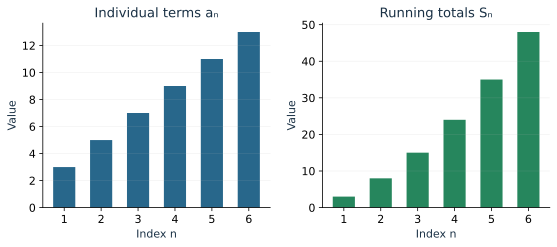
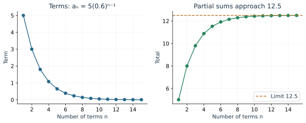
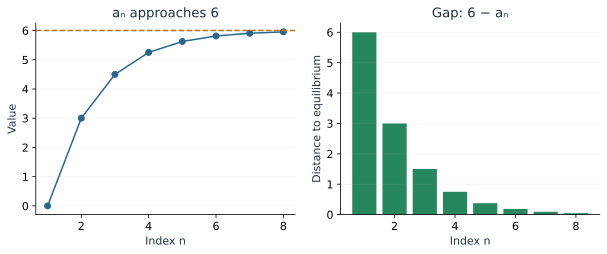

Suppose a theater adds two seats to each successive row. We can ask how many seats are in row 15, or how many seats are in the first 15 rows altogether. Those questions use the same pattern but ask for different quantities.

A sequence records individual values. A series adds them. We will build formulas from repeated addition and multiplication, keeping the meaning of each index and total in view.

## Separate a term from a running total

A sequence assigns a number \(a_n\) to each integer index in a specified list. Usually we begin at \(n=1\), though a time model may begin at \(n=0\). The first terms of \(a_n=3+2(n-1)\) are \(3,5,7,9,\ldots\).

The tenth term is \(a_{10}\). The sum of the first ten terms is \(S_{10}\):
\[
S_n=a_1+a_2+\cdots+a_n.
\]
The subscript tells you how far along the list to go. It does not mean multiplication.

For \(3,5,7,9,\ldots\), the first four partial sums are \(3,8,15,24\). The fourth term is 9, while the fourth partial sum is 24.

**Try it.** List the first five terms of \(a_n=7-3(n-1)\), then calculate their sum. Some terms are negative; include their signs.

## Repeated addition produces an arithmetic sequence

An **arithmetic sequence** adds the same common difference \(d\) at each step:
\[
a_{n+1}=a_n+d.
\]
Starting from \(a_1\), reaching term \(n\) requires \(n-1\) additions. Therefore
\[
a_n=a_1+(n-1)d.
\]
The recursive rule tells you how to take a step; the explicit formula lets you jump directly to any term.

::: {.example}
**Worked example: theater rows.** The first row has 12 seats, and each next row has 2 more. Row 15 has
\[
a_{15}=12+(15-1)(2)=40
\]
seats. There are 14 increases between the first and fifteenth rows.
:::

To add the rows, write the sequence forward and backward:
\[
\begin{aligned}
S_n&=a_1+a_2+\cdots+a_n,\\
S_n&=a_n+a_{n-1}+\cdots+a_1.
\end{aligned}
\]
Each column adds to \(a_1+a_n\), and there are \(n\) columns. Thus
\[
S_n=\frac n2(a_1+a_n)
=\frac n2\bigl(2a_1+(n-1)d\bigr).
\]
For the first 15 rows, the average of the endpoint counts is \((12+40)/2=26\). Multiplying by 15 gives 390 seats. The formula also works for an odd number of terms: the middle term equals that same average.

## Repeated multiplication produces a geometric sequence

A **geometric sequence** multiplies by the same ratio \(q\) at each step:
\[
a_{n+1}=qa_n,\qquad a_n=a_1q^{n-1}.
\]
For \(a_1=80,q=1/2\), the terms are \(80,40,20,10,5,\ldots\). With \(0<q<1\), positive terms decrease toward zero. With \(q>1\), positive terms grow. Negative ratios alternate signs.

A percentage change specifies a multiplication factor. An 8% increase multiplies by \(1.08\); a 12% decrease multiplies by \(0.88\).

::: {.example}
**Worked example: define the initial index.** A population begins at 500 and grows 8% per generation. If \(P_0=500\) records the initial population, then
\[
P_n=500(1.08)^n.
\]
If the initial observation is labeled \(a_1=500\), the formula is \(a_n=500(1.08)^{n-1}\). The physical model is the same; the labels differ by one.
:::

## Add a finite geometric pattern

Write a partial sum and its multiple by \(q\):
\[
\begin{aligned}
S_n&=a_1+a_1q+\cdots+a_1q^{n-1},\\
qS_n&=\phantom{a_1+{}}a_1q+\cdots+a_1q^{n-1}+a_1q^n.
\end{aligned}
\]
Subtracting cancels every middle term:
\[
(1-q)S_n=a_1-a_1q^n,\qquad
S_n=a_1\frac{1-q^n}{1-q}\quad(q\ne1).
\]
For \(q=1\), all terms equal \(a_1\), so the total is \(na_1\).

::: {.example}
**Worked example: a finite total.** For \(5,3,1.8,\ldots\), the ratio is \(0.6\). The sum through term 5 is
\[
S_5=5\frac{1-0.6^5}{1-0.6}=11.528.
\]
This adds five terms. The fifth term alone is \(a_5=5(0.6)^4=0.648\).
:::

The finite-sum formula works for growing, decreasing, or alternating geometric patterns, provided \(q\ne1\). It does not require convergence.

## Read sigma notation as an instruction to add

The notation
\[
\sum_{k=1}^{4}(2k+1)
\]
says: substitute \(k=1,2,3,4\), then add the four results. It becomes \(3+5+7+9=24\).

The letter \(k\) is an index used inside the instruction. The bottom and top bounds determine which values to use. For \(\sum_{k=0}^{5}2(3/2)^k\), there are six terms, since both endpoints count.

Before applying a formula, write the first few terms and the last term. This checks the first value, ratio, and number of terms.

## Can infinitely many additions have a finite total?

For the geometric pattern with \(|q|<1\), the power \(q^n\) approaches zero. The finite-sum formula then approaches
\[
\sum_{n=0}^{\infty}aq^n=\frac{a}{1-q}.
\]
An infinite sum means the limit of its partial sums. We calculate finite totals and ask what value they approach.

For \(5+3+1.8+\cdots\), the limiting total is \(5/(1-0.6)=12.5\). After \(n\) terms, the remaining amount is
\[
\frac{5(0.6)^n}{1-0.6}.
\]
This also measures how close a partial sum is to the limit.

::: {.example}
**Worked example: idealized bouncing.** Drop a ball from 5 m, with each rebound reaching 60% of the previous height. The first drop contributes 5 m. Each later rebound height contributes twice, once upward and once downward:
\[
5+2(5)(0.6+0.6^2+\cdots)
=5+10\frac{0.6}{1-0.6}=20\text{ m}.
\]
The model describes infinitely many idealized rebounds with a finite total travel distance.
:::

For a geometric series with nonzero first term, \(|q|\ge1\) prevents convergence. With \(q=2\), terms grow; with \(q=-1\), partial sums oscillate. Also, terms approaching zero alone do not guarantee convergence for every kind of series; the conclusion above follows from the geometric formula.

**Try it.** Find the sum of \(4-2+1-\tfrac12+\cdots\). Identify its ratio and explain why the alternating signs are allowed.

## A feedback rule can hide a geometric pattern

Consider
\[
a_{n+1}=\frac{a_n+6}{2},\qquad a_1=0.
\]
Each step averages the current value with 6. The first terms are \(0,3,4.5,5.25,5.625,\ldots\). The changes are not constant, and neither are the ratios of consecutive terms.

Find the equilibrium by asking which value would remain fixed:
\[
L=\frac{L+6}{2}\quad\Longrightarrow\quad L=6.
\]
Now examine the difference \(e_n=a_n-6\). Subtracting 6 from the recurrence gives
\[
e_{n+1}=\frac{e_n}{2}.
\]
The **difference from equilibrium** is geometric, even though the original sequence is not. Since \(e_1=-6\),
\[
a_n=6-6\left(\frac12\right)^{n-1}.
\]

Use the [Sequence Explorer](../demos/sequence_explorer.html) to compare terms and partial sums of arithmetic and geometric sequences. For the feedback example, compute the terms by hand and use the formula for the remaining gap to explain the approach.

## Review exercises

1. List five terms of \(a_n=7-3(n-1)\), and find \(a_{20}\).
2. For \(a_1=4,d=5\), calculate \(S_{30}\).
3. For \(a_1=81,q=1/3\), find \(a_6\).
4. Compute \(\sum_{k=0}^{5}2(3/2)^k\) exactly.
5. Explain the difference between \(\sum_{k=1}^{n}k\) and its final term \(n\).
6. Find the sum of \(5+5/2+5/4+\cdots\).
7. A machine initially worth $12,000 loses 12% of its value each year. Write its value after \(n\) years.
8. For \(a_{n+1}=(a_n+10)/2,\ a_1=2\), find the equilibrium and an explicit formula.
9. A theater has 20 rows, with 14 seats in the first and 3 more in each next row. Find the total.
10. Explain why \(1-1+1-1+\cdots\) has no limiting partial sum.

## Check your understanding

The first Try it gives \(7,4,1,-2,-5\), with sum 5. The alternating geometric series has ratio \(-1/2\) and sum \(4/(1+1/2)=8/3\). Its partial sums approach the limit from alternating sides.
