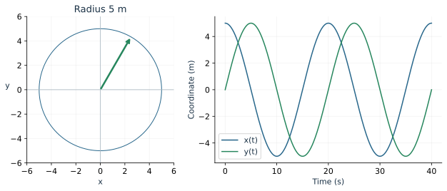
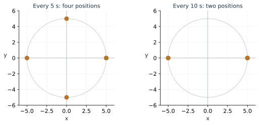
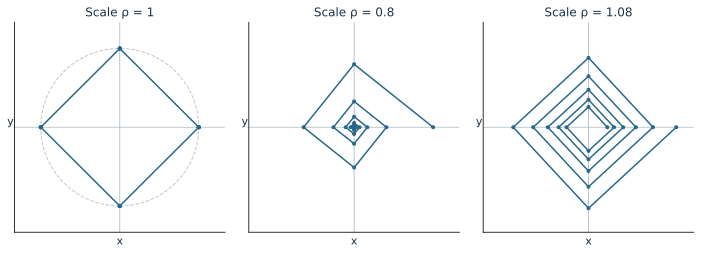
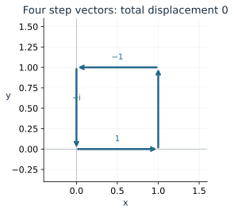

Imagine a light attached to a rotating wheel. We can record its angle, plot its coordinates, describe its position as a complex number, or take a photograph every few seconds. Each description records a different aspect of one motion.

This chapter brings those descriptions together. We will first follow a continuous rotation, then sample it, and finally combine repeated rotation with shrinking or growing distances. The goal is to choose and connect the tools developed throughout the course.

## Begin with a physical description

A point moves counterclockwise on a circle of radius 5 m, completing one turn every 20 s. It begins at the rightmost point.

The angular speed is one full turn divided by the time per turn:
\[
\omega=\frac{2\pi}{20}=\frac{\pi}{10}\text{ rad/s}.
\]
At time \(t\), the angle is \(\theta(t)=\pi t/10\). If the point had begun at another angle \(\theta_0\), we would add that initial angle.

The unit-circle formulas give the position:
\[
x(t)=5\cos\left(\frac{\pi t}{10}\right),\qquad
y(t)=5\sin\left(\frac{\pi t}{10}\right).
\]
Polar coordinates record \((r,\theta)=(5,\pi t/10)\), while complex form records
\[
z(t)=5\left(\cos\frac{\pi t}{10}+i\sin\frac{\pi t}{10}\right).
\]
All three describe a position 5 m from the origin at the same angle.

The coordinate waves have amplitude 5 and period 20 s. The circle itself has equation \(x^2+y^2=25\). That equation records the path; the time formulas additionally record orientation and timing.

## Compare position, displacement, and distance traveled

After 5 seconds, the point moves from \((5,0)\) to \((0,5)\). Its displacement is
\[
\Delta\mathbf r=\langle0-5,5-0\rangle=\langle-5,5\rangle,
\]
with magnitude \(5\sqrt2\) m.

The distance traveled is a quarter of the circumference:
\[
s=5\left(\frac{\pi}{2}\right)=\frac{5\pi}{2}\text{ m}.
\]
The curved distance exceeds the straight displacement magnitude. The average velocity over this interval is the displacement divided by elapsed time, \(\langle-1,1\rangle\) m/s. The average speed is distance divided by time, \(\pi/2\) m/s.

For constant angular speed, speed along the circle is \(R|\omega|\). The instantaneous direction is tangent to the circle. We can recognize that geometric direction without differentiating the coordinate formulas.

**Try it.** For this same motion, compare displacement and distance traveled over a complete 20-second turn.

## Sampling turns continuous motion into a sequence

Suppose a camera records the position every 5 seconds. The angle advances by
\[
\delta=\omega\Delta t=\frac{\pi}{10}(5)=\frac{\pi}{2}
\]
between photographs. Beginning with index \(n=0\), the first five positions are
\[
z_0=5,\quad z_1=5i,\quad z_2=-5,\quad
z_3=-5i,\quad z_4=5.
\]

Each sample is the previous one multiplied by \(i\). We have both a recurrence and an explicit formula:
\[
z_{n+1}=iz_n,\qquad z_n=5i^n.
\]
De Moivre's theorem expresses the same result as
\[
z_n=5\bigl(\cos(n\pi/2)+i\sin(n\pi/2)\bigr).
\]

More generally, a fixed angle step \(\delta\) corresponds to
\[
u=\cos\delta+i\sin\delta,\qquad z_{n+1}=uz_n.
\]
Repeated multiplication gives \(z_n=u^nz_0\).

The sampling interval matters. Photographing the original wheel every 20 seconds would always capture the same point. Those photographs alone would conceal the motion between them. Sampling every 10 seconds gives two alternating positions.

## Decide whether sampled positions repeat

For a nonzero starting point and unit-length multiplier, a sample returns to its start when the accumulated angle is a whole number of turns:
\[
n\delta=2\pi k
\]
for integers \(n>0,k\).

If \(\delta/(2\pi)=p/q\) in lowest terms with \(q>0\), the first return is after \(q\) steps. For example, \(\delta=4\pi/5\) is \(2/5\) of a turn, so five steps close the sampled orbit. The points are visited in a star order rather than around consecutive edges.

If \(\delta/(2\pi)\) is irrational, no positive integer number of steps gives an exact return. A finite computer display can look almost closed, so distinguish a close approach from mathematical equality.

## Add a scale change at each step

Now let the multiplier have modulus \(\rho>0\):
\[
q=\rho(\cos\delta+i\sin\delta),\qquad z_{n+1}=qz_n.
\]
After \(n\) steps,
\[
z_n=q^nz_0,\qquad |z_n|=\rho^n|z_0|.
\]
The angle advances by \(n\delta\), measured modulo full turns. The distance from the origin follows a geometric sequence.

For \(0<\rho<1\), radii shrink toward zero. For \(\rho=1\), they stay constant. For \(\rho>1\), they grow. These statements describe a nonzero starting point. The origin stays fixed.

::: {.example}
**Worked example: track three shrinking quarter-turns.** Start at \(z_0=4\) and multiply by \(q=i/2\):
\[
z_1=2i,\qquad z_2=-1,\qquad z_3=-\frac12i.
\]
The radius halves each step: \(4,2,1,1/2\). The angle adds \(90^\circ\): \(0^\circ,90^\circ,180^\circ,270^\circ\). The explicit formula is
\[
z_n=4\left(\frac12\right)^n
\bigl(\cos(n\pi/2)+i\sin(n\pi/2)\bigr).
\]
The angular pattern repeats, while the positions do not: their nonzero magnitudes keep decreasing.
:::

**Try it.** Begin with \(z_0=2\) and use \(q=\tfrac12(\cos60^\circ+i\sin60^\circ)\). Find the modulus, direction, and rectangular value of \(z_3\).

## Adding step vectors builds a different sequence

The recurrence above multiplies the **position** at each step. Another model specifies the **displacement** during each step. If those steps are \(\Delta z_n=aq^n\), starting from position \(z_0\), then
\[
z_N-z_0=\sum_{n=0}^{N-1}aq^n
=a\frac{1-q^N}{1-q}\qquad(q\ne1).
\]
The geometric-sum algebra also works for complex numbers, since multiplication and subtraction obey the same distributive rules.

For steps \(1,i,i^2,i^3\), the total displacement is \(1+i-1-i=0\). From the origin, the running positions are \(0,1,1+i,i,0\). Those positions are the corners of a square.

For shrinking steps \(a(i/2)^n\), the step lengths approach zero. Their total displacement approaches \(a/(1-i/2)\). The final position depends on both that sum and the starting point. Always decide whether a formula describes locations or movements between locations.

## Choose a representation that answers the question

A model begins with quantities and units. For rotating machinery, angle and period may be the natural measurements. For navigation, components help add movements. For repeated scaling and rotation, complex multiplication gives a compact rule. For a path with a particular timing, parametric equations supply both coordinates at each instant.

These choices also reveal the assumptions. A constant-speed circle needs a fixed radius and angular speed. An ellipse has a different relation between its horizontal and vertical coordinates. An idealized projectile uses constant horizontal velocity and downward acceleration. Select a model because its assumptions fit the question.

Use the [Motion Synthesizer](../demos/motion_synthesis.html) to vary the scale and angle independently. Fix one control while investigating the other. Then explain the plotted pattern through its radius sequence and angle sequence.

## Review exercises

1. Write Cartesian, polar, and complex formulas for radius 5 and period 20 s, starting on the positive horizontal axis.
2. Sample every 5 s. Give the first five complex positions and the repetition period in samples.
3. For \(z_{n+1}=iz_n,\ z_0=1+i\), find \(z_1,\ldots,z_4\).
4. For \(z_{n+1}=(i/2)z_n,\ z_0=4\), find \(z_4\) and describe its magnitude and direction.
5. Eliminate \(t\) from \(x=3\cos t,\ y=2\sin t\).
6. Explain why a circle can repeat while a shrinking spiral from a nonzero point does not.
7. Interpret \(1+i+i^2+i^3\) as four step vectors.
8. Describe one process with at least three mathematical representations from the course.
9. A circle is sampled with angle step \(4\pi/5\). How many steps give its first return?
10. Explain what photographs every full revolution would reveal and what information they would miss.

## Check your understanding

Over a complete turn, displacement is zero and traveled distance is \(10\pi\) m. In the shrinking \(60^\circ\) example, after three steps the modulus is \(2(1/2)^3=1/4\), the direction is \(180^\circ\), and \(z_3=-1/4\).
